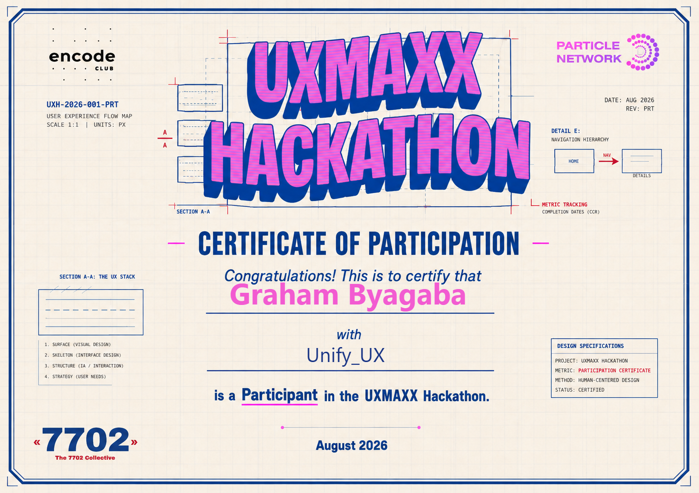

<p align="center"><a href="https://github.com/grahamaine"></a></p>

# Universal Pay

**Pay or split with anyone — any chain, any token, one balance.**

A Venmo-style payments app that turns the messy reality of multi-chain crypto
into a single spendable balance. Sign in with an email, and your wallet becomes
a **chain-abstracted account in place** via **EIP-7702** — no new address, no
migration, no smart-account deployment. Send, split, request, earn yield, and
move value across chains, all from one number.

🔗 **Live demo:** https://unify-ux.vercel.app

---

## 🏆 Recognition

**UXMAXX Hackathon — Certificate of Participation** · Encode Club × Particle Network (The 7702 Collective) · August 2026.
Awarded to **Graham Byagaba** for **Unify_UX**.



---

## Built for the Particle Network Universal Accounts track

This app is built on **[Particle Network's Universal Accounts SDK](https://developers.particle.network/universal-accounts/cha/overview)
in EIP-7702 mode**. The user's existing EOA is upgraded in place to act directly
as the Universal Account — one login, one balance, and transactions on any chain
with any asset.

It targets three stackable prizes with one app:

| Track | How we qualify |
| --- | --- |
| **Particle Universal Accounts (EIP-7702)** | `UniversalAccount` runs in 7702 mode (`useEIP7702: true`). The account *is* the user's EOA — proven in-app in the "Under the hood" panel. |
| **Arbitrum** | Every transfer, deposit, and yield deposit settles on **Arbitrum One** (chainId `42161`) — and the app ships its **own contract deployed & source-verified on Arbitrum One**: [`UniversalPayReceipts`](https://arbiscan.io/address/0xF1d421e02d92D89f28AFdfAB3223E60644a36eCA#code). |
| **Magic** | Email-OTP embedded-wallet login provides the EOA that gets upgraded. |

### The cross-chain operation, three ways

The Universal Account sources value from **whatever the user holds, on whatever
chain it sits on**, with no manual bridging and no native gas token required:

- **Add funds** — cross-chain deposit consolidating any asset onto Arbitrum.
- **Pay / Split** — transfers settle a chosen token on Arbitrum, auto-sourced cross-chain.
- **Universal Earn** — supply into Aave v3 on Arbitrum, funded from assets on any chain.

### Deployed on Arbitrum One

The app's own on-chain component, **`UniversalPayReceipts`**, is deployed and
source-verified on Arbitrum One:

- **Contract:** [`0xF1d421e02d92D89f28AFdfAB3223E60644a36eCA`](https://arbiscan.io/address/0xF1d421e02d92D89f28AFdfAB3223E60644a36eCA#code)
- **Source:** [`contracts/UniversalPayReceipts.sol`](contracts/UniversalPayReceipts.sol) (solc 0.8.28, MIT)
- **What it does:** `payWithReceipt(token, to, amount, note)` pulls the ERC-20
  payment from the payer, forwards it to the recipient in the same call, and
  emits an indexed `Receipt` event — a verifiable on-chain record of every
  Universal Pay payment. No owner, holds no funds, not upgradeable.
- **Where to see it in-app:** linked in the footer of every page (with the full
  address), and in the signed-in dashboard's **"Under the hood"** panel — both
  link straight to the verified source on Arbiscan.

---

## What it does

**Payments**
- 📧 **Email login** → EOA upgraded to a Universal Account via EIP-7702
- 💸 **Send & split** — pay one person or many; split by amount, evenly, or by share
- 🧾 **Requests & invoices** — shareable pay-links + QR, tracked to paid/unpaid
- 👥 **Groups & settle-up** — track shared expenses, then settle with one tap
- 📇 **Contacts**, **QR receive/scan**, **CSV export**, **transaction history**

**DeFi — what most dapps can't do without chain abstraction**
- ✦ **Universal Earn** — one-tap yield on your *whole* balance (Aave v3 USDC on Arbitrum), funded cross-chain, withdraw anytime
- 🔁 **Consolidate** — sweep scattered tokens into spendable USDC in one move
- 🔎 **Transaction preview** — before signing, see which chains funded the action, swaps routed, the fee, and "no gas token needed"
- 🛠 **Under the hood** — judge-facing EIP-7702 proof: your address *is* your login EOA, upgraded in place, plus a per-chain breakdown of where your unified balance lives

---

## Tech stack

- **[Next.js 16](https://nextjs.org/)** (App Router, Turbopack) · **React 19** · **TypeScript** · **Tailwind CSS v4**
- **[@particle-network/universal-account-sdk](https://developers.particle.network/)** — Universal Accounts in EIP-7702 mode
- **[@particle-network/universal-deposit](https://developers.particle.network/)** — cross-chain deposits
- **[magic-sdk](https://magic.link/)** — email-OTP embedded wallet
- **[ethers v6](https://docs.ethers.org/v6/)** — signing + Aave reads
- **Aave v3** on Arbitrum — yield (`supply` / `withdraw`)

---

## How it works

```
Email OTP (Magic)
      │  embedded-wallet EOA
      ▼
UniversalAccount({ smartAccountOptions: { useEIP7702: true, ... } })
      │  same address, upgraded in place
      ▼
getPrimaryAssets()  ──►  one unified balance (aggregated across every chain)
      │
      ├─ createTransferTransaction      → pay / split        (settles on Arbitrum)
      ├─ createUniversalTransaction     → Earn (Aave supply) / withdraw
      └─ createConvertTransaction       → consolidate to USDC
                 │
                 ▼
   build → preview (tokenChanges) → confirm → sign(rootHash) → sendTransaction
```

Every action is **built and previewed before it is signed**: the SDK returns a
transaction whose `tokenChanges` reveal the source chains, swaps, and fee — which
the app surfaces so the chain-abstraction is visible, not magic.

---

## Run it locally

```bash
npm install

# create .env.local with your own keys (see below)
npm run dev
```

Open http://localhost:3000.

> **Note:** for email login to work locally, add `http://localhost:3000` to the
> domain allowlist in both the Magic and Particle dashboards. Without keys the
> app degrades gracefully to the sign-in screen (no hang).

### Environment variables

Create `.env.local` (all are public, client-side keys):

```bash
NEXT_PUBLIC_MAGIC_KEY=pk_live_...
NEXT_PUBLIC_PARTICLE_PROJECT_ID=...
NEXT_PUBLIC_PARTICLE_CLIENT_KEY=...
NEXT_PUBLIC_PARTICLE_APP_ID=...
```

Server secrets (Particle Server Key, Magic `sk_live`) are **never** used in this
client app.

---

## Project structure

```
src/
├── app/
│   ├── page.tsx          # dashboard: balance, send/split, earn, proof panel, modals
│   ├── layout.tsx        # dark theme shell + splash
│   └── globals.css       # forced dark theme, animations
├── components/           # Modal, TokenPicker, QR, Receive/Scan/Contacts, Groups, Requests, …
├── hooks/
│   ├── useUniversalPay.ts  # the core: session, balance, build→preview→confirm engine
│   ├── useActivity.ts      # localStorage transaction history
│   ├── useContacts.ts / useRequests.ts / useGroups.ts
└── lib/
    ├── constants.ts      # Arbitrum settlement chain + USDC (SSR-safe literals)
    ├── tokens.ts         # settlement-token registry + balance metadata
    ├── defi.ts           # Aave v3 supply/withdraw calldata + position reader
    ├── links.ts          # pay-link encode/parse
    └── magic.ts          # Magic client
```

### Implementation notes

- **SSR safety** — the Universal Account SDK is browser-only. Shared modules
  (`constants.ts`, `tokens.ts`, `defi.ts`) avoid importing it and use literal
  chain ids/addresses; the SDK is only touched inside the client hook.
- **Turbopack interop** — the SDK's `exports` map is pinned in
  `next.config.ts` (`turbopack.resolveAlias`) so the browser build resolves the
  real module instead of an empty one.
- **Settlement** — everything lands on **Arbitrum One** for predictable,
  low-fee finality.

---

## Status

All core flows build and type-check clean, and the live deployment at
[unify-ux.vercel.app](https://unify-ux.vercel.app) is current. The
[`UniversalPayReceipts`](https://arbiscan.io/address/0xF1d421e02d92D89f28AFdfAB3223E60644a36eCA#code)
contract is deployed and source-verified on Arbitrum One. The DeFi flows
(Earn / withdraw / consolidate) run against **mainnet** Aave and require a
funded account; test with a small amount before relying on them.

---

_Built for the UXmm hackathon._

---

<!-- thee-agency-portfolio:start -->
## More work by thee AGENCY Consults (UG) Limited

### Web portals & websites

| Project | What it is | Live link |
|---|---|---|
| 6 Summits Rwenzori | Trekking & safari website with an owner console | [6summitsafrica.com](https://www.6summitsafrica.com) |
| Airport View Hotel | Hotel website, Entebbe | [airportviewhotel.co.ug](https://airportviewhotel.co.ug) |
| StudioX Uganda | Photography, videography & film production app | [studiox-client.vercel.app](https://studiox-client.vercel.app) |
| Attitude Aviation Academy | Academy admin portal | [attitude-aviation-portal.vercel.app](https://attitude-aviation-portal.vercel.app) |
| Relish Spa & Wellness | Spa & wellness website | [relish-spa-wellness.vercel.app](https://relish-spa-wellness.vercel.app) |
| Construction Consultancy | Consultancy company website | [construction-consultancy-site.vercel.app](https://construction-consultancy-site.vercel.app) |

### dApps (open source)

[Kakasa (cord-dapp)](https://github.com/grahamaine/cord-dapp) ·
[Pamoja](https://github.com/grahamaine/Pamoja) ·
[Universal Pay](https://github.com/grahamaine/universal-pay) ·
[ChainLinks](https://github.com/grahamaine/ChainLinks) ·
[KitePay](https://github.com/grahamaine/KitePay_) ·
[Aura Agentic](https://github.com/grahamaine/aura-agentic) ·
[Mezo Legacy](https://github.com/grahamaine/Mezo_Legacy) ·
[Arc Legacy](https://github.com/grahamaine/arc-legacy) ·
[Cantongun](https://github.com/grahamaine/cantongun-dapp) ·
[Moove Build](https://github.com/grahamaine/moove-build) ·
[Solana Dev](https://github.com/grahamaine/solana-dev) ·
[Habitual Trends](https://github.com/grahamaine/habitual_trends)

**Contact:** ✉️ [ainegb05@gmail.com](mailto:ainegb05@gmail.com) · 💬 WhatsApp [+256 742 701 202](https://wa.me/256742701202)
<!-- thee-agency-portfolio:end -->

<p align="center">
  <a href="https://github.com/grahamaine"></a><br>
  <b>Powered &amp; rendered by thee AGENCY Consults (UG) Limited</b><br>
  <sub>Innovation Unleashed · Web Portals · dApps · Websites · Entebbe, Uganda</sub>
</p>
